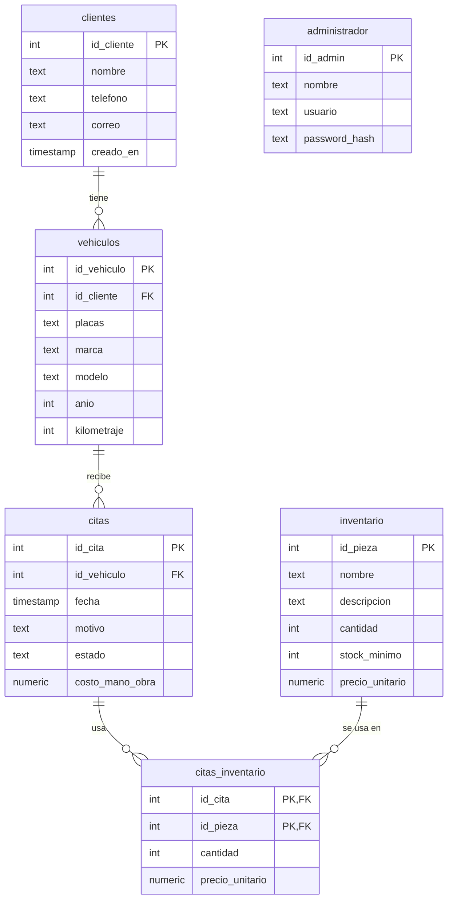

# Mqueen · Modelo de datos y reglas de negocio

> Documento de referencia para el desarrollo del **Sistema de Gestión Mqueen** (Proyecto Integrador I, UTD).
> Cliente: **Taller Mecánico Auto Green**. Alcance principal: **gestión de inventario de refacciones**, ligado a clientes, vehículos y citas de servicio.
> Fuente de verdad: la base PostgreSQL existente. **No cambiar el esquema sin actualizar este documento.**

---

## 1. Contexto técnico

| Dato | Valor |
|---|---|
| Motor | PostgreSQL (local, `localhost:5432`) |
| Base de datos | `Boceto de BD para Mqueen` |
| Esquema | **`"BD"`** (en mayúsculas, con comillas). Las tablas **no** están en `public`. |
| Usuarios del sistema | Solo **administrador**. Los clientes **no** tienen login. |
| Herramienta de administración | DBeaver |

Toda conexión desde código debe fijar el esquema, por ejemplo:

```sql
SET search_path TO "BD";
```

También se puede calificar cada tabla: `"BD".inventario`.

---

## 2. Diagrama de relaciones

```
clientes 1 ──< N vehiculos 1 ──< N citas 1 ──< N citas_inventario N >── 1 inventario

administrador   (tabla independiente, sin relaciones)
```



> El diagrama muestra los tipos de forma resumida. Los tipos exactos están en la sección 3 y se confirmaron contra la base real el 2026-11-12 (consultando `information_schema` y `pg_constraint`).

---

## 3. Tablas

### 3.1 `clientes`
Personas dueñas de los vehículos que llegan al taller.

| Columna | Tipo | Notas |
|---|---|---|
| `id_cliente` | `integer` (serial) | PK, autogenerado |
| `nombre` | `varchar(100)` | Obligatorio. Nombre completo |
| `telefono` | `varchar(15)` | Obligatorio. Texto, no número (puede llevar ceros o guiones) |
| `correo` | `varchar(100)` | **Opcional** (acepta nulo). No es único |
| `creado_en` | `timestamp` | Obligatorio. La base pone `now()` si no se manda |
| `activo` | `boolean` | Obligatorio, por defecto `true`. **Baja lógica** (agregada el 2026-11-12): `false` = dado de baja |

### 3.2 `vehiculos`
Cada vehículo pertenece a **un** cliente. Un cliente puede tener **varios** vehículos.

| Columna | Tipo | Notas |
|---|---|---|
| `id_vehiculo` | `integer` (serial) | PK, autogenerado |
| `id_cliente` | `integer` | Obligatorio. FK → `clientes.id_cliente`, **`ON DELETE CASCADE`** |
| `placas` | `varchar(15)` | Obligatorio y **único**. Identificador práctico del vehículo |
| `marca`, `modelo` | `varchar(50)` | Obligatorios |
| `anio` | `integer` | Opcional. CHECK: entre 1950 y 2100 |
| `kilometraje` | `integer` | Opcional. CHECK: `>= 0`. Último kilometraje registrado |
| `activo` | `boolean` | Obligatorio, por defecto `true`. **Baja lógica** (agregada el 2026-11-12): `false` = dado de baja |

Un vehículo cuenta como activo solo si él **y su cliente** tienen `activo = true`.

### 3.3 `citas`
Servicio programado o realizado a un vehículo. Es el **encabezado** de la nota de servicio.

| Columna | Tipo | Notas |
|---|---|---|
| `id_cita` | `integer` (serial) | PK, autogenerado |
| `id_vehiculo` | `integer` | Obligatorio. FK → `vehiculos.id_vehiculo`, **`ON DELETE CASCADE`** |
| `fecha` | `timestamp` | Obligatorio. Fecha y hora de la cita |
| `motivo` | `varchar(255)` | Obligatorio. Ej. "Afinación mayor" |
| `estado` | `varchar(20)` | Obligatorio, por defecto `'Pendiente'`. **CHECK**: solo `'Pendiente'`, `'En proceso'`, `'Terminada'`, `'Cancelada'` |
| `costo_mano_obra` | `numeric(10,2)` | **Acepta nulo**, por defecto `0`. CHECK: `>= 0`. En MXN |

### 3.4 `inventario`
Catálogo y existencias de refacciones del taller.

| Columna | Tipo | Notas |
|---|---|---|
| `id_pieza` | `integer` (serial) | PK, autogenerado |
| `nombre` | `varchar(100)` | Obligatorio. No es único. Ej. "Bujía de iridio" |
| `descripcion` | `varchar(255)` | Opcional |
| `cantidad` | `integer` | Obligatorio, por defecto `0`. CHECK: `>= 0`. Existencia actual |
| `stock_minimo` | `integer` | Obligatorio, por defecto `0`. CHECK: `>= 0`. Umbral de alerta |
| `precio_unitario` | `numeric(10,2)` | Obligatorio. CHECK: `>= 0` (la base permite 0; RN-03 pide mayor a 0). Precio **actual** de venta, en MXN |

### 3.5 `citas_inventario` (tabla intermedia, el detalle del ticket)
Resuelve la relación **muchos a muchos** entre `citas` e `inventario`: una cita usa varias piezas y una pieza aparece en muchas citas.

| Columna | Tipo | Notas |
|---|---|---|
| `id_cita` | `integer` | PK compuesta + FK → `citas`, **`ON DELETE CASCADE`** |
| `id_pieza` | `integer` | PK compuesta + FK → `inventario` (sin cascada: la base no deja borrar una pieza usada en alguna cita) |
| `cantidad` | `integer` | Obligatorio. CHECK: `> 0`. Unidades usadas en esa cita |
| `precio_unitario` | `numeric(10,2)` | Obligatorio. CHECK: `>= 0`. **Precio congelado al momento de la cita** |

- La PK `(id_cita, id_pieza)` impide repetir la misma pieza en una cita. Si se usan más unidades, se actualiza `cantidad`.
- `precio_unitario` se copia de `inventario` al registrar la pieza. Si el precio cambia después, los tickets anteriores **no** cambian.

**Ticket o nota de servicio** = `citas` (encabezado) + sus filas de `citas_inventario` (renglones).

### 3.6 `administrador`
Único tipo de usuario del sistema. No se relaciona con otras tablas.

| Columna | Tipo | Notas |
|---|---|---|
| `id_admin` | `integer` (serial) | PK, autogenerado |
| `nombre` | `varchar(100)` | Obligatorio |
| `usuario` | `varchar(50)` | Obligatorio. **UNIQUE** (`administrador_usuario_key`) |
| `password_hash` | `varchar(255)` | Obligatorio. Nunca guardar la contraseña en texto plano. Usar bcrypt o argon2 en la app. |

---

## 4. Restricciones confirmadas en la base

| Restricción | Tabla | Regla |
|---|---|---|
| `citas_estado_check` | `citas` | `estado IN ('Pendiente','En proceso','Terminada','Cancelada')` |
| `citas_costo_mano_obra_check` | `citas` | `costo_mano_obra >= 0` |
| `administrador_usuario_key` | `administrador` | `usuario` es único |
| `vehiculos_placas_key` | `vehiculos` | `placas` es único |
| `vehiculos_anio_check` | `vehiculos` | `anio` entre 1950 y 2100 |
| `vehiculos_kilometraje_check` | `vehiculos` | `kilometraje >= 0` |
| `inventario_cantidad_check` | `inventario` | `cantidad >= 0` |
| `inventario_stock_minimo_check` | `inventario` | `stock_minimo >= 0` |
| `inventario_precio_unitario_check` | `inventario` | `precio_unitario >= 0` |
| `citas_inventario_cantidad_check` | `citas_inventario` | `cantidad > 0` |
| `citas_inventario_precio_unitario_check` | `citas_inventario` | `precio_unitario >= 0` |
| PK compuesta | `citas_inventario` | `(id_cita, id_pieza)` |
| `vehiculos_id_cliente_fkey` | `vehiculos` | FK → `clientes`, `ON DELETE CASCADE` |
| `citas_id_vehiculo_fkey` | `citas` | FK → `vehiculos`, `ON DELETE CASCADE` |
| `citas_inventario_id_cita_fkey` | `citas_inventario` | FK → `citas`, `ON DELETE CASCADE` |
| `citas_inventario_id_pieza_fkey` | `citas_inventario` | FK → `inventario`, sin cascada (bloquea el borrado) |

No hay triggers en el esquema.

> **Cuidado con las cascadas:** en la base, borrar un cliente borra sus vehículos, las citas de esos vehículos y los renglones de sus tickets. **Por eso la aplicación nunca borra clientes, vehículos ni citas** (decidido el 2026-11-12): a clientes y vehículos se les da baja lógica con la columna `activo`, y las citas se cancelan. Si se borra algo a mano desde DBeaver, la cascada sí se aplica.

---

## 5. Reglas de negocio

**Leyenda**
- ✅ = ya la garantiza la base de datos
- 🟡 = debe implementarse en la aplicación (o agregarse como constraint o trigger)

### Inventario
| ID | Regla | Estado |
|---|---|---|
| RN-01 | No se puede descontar más piezas de las que hay en existencia (`cantidad` nunca queda negativa). | ✅ `CHECK (cantidad >= 0)`. Aun así, la app valida antes para responder "Stock insuficiente" en vez de un error de la base. |
| RN-02 | Si `cantidad <= stock_minimo`, la pieza se marca como **Stock bajo** y se genera una alerta. | 🟡 Es un cálculo, no se guarda. RN-16 separa esa alerta en dos niveles. |
| RN-03 | `precio_unitario` debe ser mayor a 0. | 🟡 La base solo exige `>= 0` (permite precio 0). El "mayor a 0" lo valida la app. |
| RN-04 | `cantidad` y `stock_minimo` no pueden ser negativos. | ✅ `CHECK (... >= 0)` en ambas columnas. La app valida antes para dar un mensaje claro. |
| RN-05 | Valor del inventario = Σ(`cantidad` × `precio_unitario`). | 🟡 Cálculo |
| RN-16 | Cada pieza tiene un **nivel de stock**: **Crítico** si está agotada (`cantidad = 0`) o si `cantidad <= stock_minimo / 2`; **Stock bajo** si no es crítico y `cantidad <= stock_minimo`; **Suficiente** en cualquier otro caso. | 🟡 Es un cálculo, no una columna (agregada el 2026-11-13). |

Notas de RN-16:
- Detalla a RN-02, no la reemplaza: toda pieza en Crítico o en Stock bajo cumple `cantidad <= stock_minimo`, así que sigue contando como alerta de stock bajo.
- Para no usar decimales, "`cantidad <= stock_minimo / 2`" se calcula como `cantidad * 2 <= stock_minimo`.
- Ejemplo con `stock_minimo = 6`: de 0 a 3 piezas es Crítico, de 4 a 6 es Stock bajo y de 7 en adelante es Suficiente.
- Con `stock_minimo = 0`, la pieza es Crítico solo cuando está agotada.

### Citas y ticket
| ID | Regla | Estado |
|---|---|---|
| RN-06 | El estado de una cita solo puede ser Pendiente, En proceso, Terminada o Cancelada. | ✅ CHECK |
| RN-07 | Al agregar una pieza a una cita, se **descuenta del inventario** en la misma transacción (aplica RN-01). | 🟡 Transacción en la app |
| RN-08 | `citas_inventario.precio_unitario` se copia del precio vigente en `inventario` al momento de agregar la pieza. | 🟡 App |
| RN-09 | Total de la cita = `costo_mano_obra` + Σ(`cantidad` × `precio_unitario` del detalle). | 🟡 Cálculo (consulta Q4) |
| RN-10 | Una cita **Cancelada** no consume inventario. Al cancelarla, sus piezas regresan al stock en la misma transacción; los renglones se conservan como historial y su total es 0. | 🟡 App (decidido el 2026-11-12) |
| RN-11 | Una cita **Terminada** o **Cancelada** queda cerrada: no se edita, no cambia de estado y no se le agregan ni quitan piezas. | 🟡 App (decidido el 2026-11-12) |
| RN-12 | Toda cita pertenece a un vehículo existente, y todo vehículo a un cliente existente. | ✅ FK |

### Acceso
| ID | Regla | Estado |
|---|---|---|
| RN-13 | Solo el administrador inicia sesión. Los clientes no tienen cuenta. | Diseño |
| RN-14 | El nombre de `usuario` del administrador es único. | ✅ UNIQUE |
| RN-15 | Las contraseñas se guardan con hash seguro (bcrypt o argon2), nunca en texto plano. | 🟡 App |

---

## 6. Algoritmo de referencia: descontar refacción (RN-01, RN-02)

```
Algoritmo DescontarRefaccion
Entradas: idPieza, cantSolicitada
Inicio
  Si cantSolicitada <= 0 Entonces Mostrar "Cantidad no válida"; Terminar
  existencia ← obtenerCantidad(idPieza)
  Si existencia < cantSolicitada Entonces Mostrar "Stock insuficiente"; Terminar   // RN-01
  existencia ← existencia - cantSolicitada
  actualizarCantidad(idPieza, existencia)
  Si existencia <= stockMinimo(idPieza) Entonces Mostrar "Alerta: stock bajo"      // RN-02
  Mostrar "Refacción descontada"
Fin
```

Implementación atómica en SQL, sin condición de carrera:

```sql
UPDATE "BD".inventario
SET cantidad = cantidad - $1
WHERE id_pieza = $2 AND cantidad >= $1
RETURNING cantidad, stock_minimo;
-- 0 filas devueltas → stock insuficiente
```

---

## 7. Consultas clave ya probadas

| ID | Propósito |
|---|---|
| Q1 | Refacciones con stock bajo (`cantidad <= stock_minimo`) |
| Q2 | Citas del día con cliente y vehículo |
| Q3 | Historial de servicios por placas |
| Q4 | Total por cita (mano de obra + refacciones) → ticket |
| Q5 | Refacciones más usadas |
| Q6 | Valor total del inventario |

El SQL completo está en `docs/sql/mqueen_datos_y_consultas.sql` (y `mqueen_continuacion.sql`, que se usó tras el error de estados). Ojo: el primero usa el estado `Completada`, que la BD rechaza; la continuación ya usa `Terminada`. Son registro histórico: no volver a ejecutarlos.

---

## 8. Datos de prueba cargados

- Conteo real al 2026-11-12, después de la limpieza: 8 clientes, 9 vehículos, **36 refacciones** (11 con stock bajo, una de ellas agotada), 9 citas, 12 renglones en `citas_inventario` y 1 administrador.
- El script de datos de prueba aportó 6 clientes, 7 vehículos, 12 refacciones y 7 citas. Había además registros anteriores al script.
- **Limpieza del 2026-11-12** (`docs/sql/mqueen_limpieza_y_catalogo.sql`, aprobada por Rodolfo): se eliminaron las piezas repetidas con `id_pieza` 1, 2 y 3; sus renglones en citas pasaron a las piezas 4, 5 y 7. Se agregaron 24 refacciones nuevas. Ya no hay nombres repetidos. Los `id_pieza` van ahora de 4 a 39.
- **Sin acentos desde el 2026-11-12** (`docs/sql/mqueen_quitar_acentos.sql`, aprobado por Rodolfo): `nombre` y `descripcion` de `inventario` se guardan sin acentos y conservan la `ñ`. Se cambiaron 21 piezas.
- **Baja lógica, 2026-11-12** (`docs/sql/mqueen_fase3_baja_logica.sql`, aprobado por Rodolfo): se agregó la columna `activo` a `clientes` y `vehiculos` (todos quedaron activos) y se quitaron los acentos de `clientes.nombre`, `vehiculos.marca`, `vehiculos.modelo` y `citas.motivo`. No cambió el número de filas.
- Antes de cada uno de estos cambios se guardó un respaldo local de las tablas afectadas. Los respaldos no se incluyen en el repositorio.
- Los scripts de `docs/sql/` ya se ejecutaron una vez. **No volver a correrlos**, porque duplican registros.

---

## 9. Pendientes por decidir

- [x] Confirmar tipos exactos y reglas `ON DELETE` (hecho el 2026-11-12; ver secciones 3 y 4).
- [x] `CHECK` de RN-01 y RN-04: ya existen en la base.
- [ ] RN-03: la base permite precio 0. Decidir si se cambia el `CHECK` a `> 0` (alterar la base requiere aprobación) o si basta con validarlo en la app.
- [x] RN-10 y RN-11: decididas el 2026-11-12 (ver sección 5).
- [x] Cascadas: la app nunca borra clientes, vehículos ni citas; usa baja lógica y cancelación.
- [x] `placas` ya es `UNIQUE`.
- [ ] Decidir si `correo` (clientes) y `nombre` (inventario) deben ser únicos.
